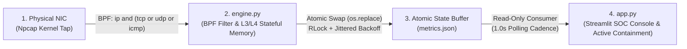
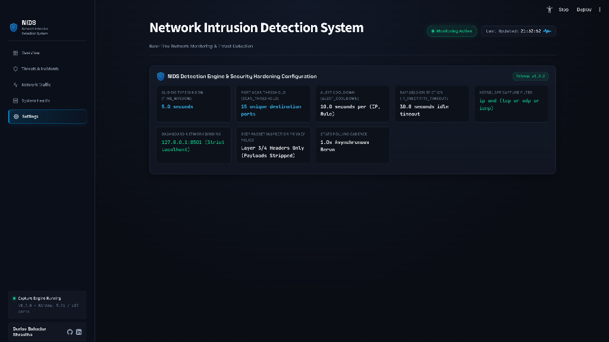

# nids-core: Autonomous Layer-3/4 Network Intrusion Detection System & SOC Console

[](https://www.python.org/)
[](https://scapy.net/)
[](https://streamlit.io/)
[](https://attack.mitre.org/techniques/T1046/)
[-10B981?style=for-the-badge&logo=pytest&logoColor=white)](#automated-test-suite--verification)
[](#quickstart--single-command-launch)

> Developed by **Durlav Bahadur Shrestha** (BSc Cyber Security, Ravensbourne University London | GitHub: [`durlav-stha`](https://github.com/durlav-stha) | LinkedIn: [`in/durlav-stha`](https://www.linkedin.com/in/durlav-bahadur-shrestha-a1a307444/))

---

## Executive Overview

**`nids-core`** is a real-time, decoupled Layer-3/4 Network Intrusion Detection System (NIDS) and Dark Security Operations Center (SOC) Command Console engineered in Python. Designed for low-latency host and local-subnet reconnaissance detection, `nids-core` taps directly into the network interface via an **Npcap / libpcap kernel Berkeley Packet Filter (BPF)**, tracks per-source connection state across a sliding time window in RAM, and streams telemetry through a lock-resilient atomic state buffer to an isolated localhost SOC visualization plane.


---

## System Architecture & Dataflow

`nids-core` enforces a strict **4-tier decoupled producer-consumer pipeline** so high-throughput packet ingestion on the wire is never blocked by UI rendering or disk I/O contention:



```text
+---------------------------------------------------------------------------------------------------+
|                                   nids-core 4-Tier Dataflow                                       |
+---------------------------------------------------------------------------------------------------+
|                                                                                                   |
|  [ Tier 1: Physical NIC ]          Npcap / libpcap Kernel Tap (Promiscuous / Layer-2 Ingress)     |
|             |                      Kernel Filter: "ip and (tcp or udp or icmp)"                   |
|             v                                                                                     |
|  [ Tier 2: engine.py ]             Zero-Payload L3/L4 Header Parser + Sliding-Window RAM Matrix   |
|             |                      - Tracks unique TCP SYN (0x02, ACK=0) destination ports        |
|             |                      - 5.0s sliding window | >=15 ports threshold | 10.0s cooldown  |
|             |                      - 30.0s idle host eviction to prevent memory exhaustion        |
|             v                                                                                     |
|  [ Tier 3: metrics.json ]          Decoupled Atomic State Buffer (NTFS Concurrency Hardened)      |
|             |                      - Write: metrics.json.tmp -> flush/fsync -> os.replace()       |
|             |                      - Sync: threading.RLock() + exponential backoff with jitter    |
|             v                                                                                     |
|  [ Tier 4: app.py (127.0.0.1) ]    Dark SOC Command Console & Active Incident Containment         |
|                                    - Real-time liveness heartbeat verification (<=3.0s threshold) |
|                                    - MITRE ATT&CK T1046 forensics & PowerShell firewall synthesis |
+---------------------------------------------------------------------------------------------------+
```

### Privacy-First Zero Payload Inspection Policy

To eliminate sensitive data retention and prevent credential or PII leakage into telemetry logs, **`nids-core` enforces a strict Zero Payload Inspection Policy**:
- **Layer-3/4 Header Extraction Only**: `engine.py` inspects exclusively IPv4 source/destination addresses (`IP.src`, `IP.dst`), protocol identifiers, and Layer-4 transport headers (`TCP.dport`, `TCP.flags`, `UDP`, `ICMP`).
- **Systematic Payload Suppression**: Raw application-layer payloads (`Raw` layer, HTTP bodies, TLS records, DNS queries, SMB frames) are never parsed, buffered in memory, or serialized to `metrics.json`.
- **Consumer Whitelisting**: `app.py` passes every ingested alert through `sanitize_alerts()`, which enforces a strict schema whitelist (`timestamp`, `rule`, `source_ip`, `severity`, `explanation`) prior to UI rendering.

---

## Core Engineering & Concurrency Resilience

### 1. Windows NTFS Concurrency Fix (`RLock` + Jittered Exponential Backoff)

On Windows NTFS filesystems, concurrent high-frequency writes from a packet-capture thread and asynchronous reads from a dashboard polling loop frequently trigger kernel file-locking collisions (`PermissionError: [WinError 5] Access is denied` or `[WinError 32] The process cannot access the file because it is being used by another process`) during atomic rename operations (`os.replace`).

`nids-core` resolves this at both ends of the state bridge:
- **Reentrant Synchronization (`threading.RLock`)**: `engine.py` guards all state mutations, alert evaluations, and file flushes with a reentrant lock (`lock = threading.RLock()`). Because `packet_handler()` acquires `lock` and invokes `evaluate_stateful_scan()`, which immediately flushes critical alerts to disk via `atomic_write_metrics()`, reentrant locking guarantees zero self-deadlock on the same thread when a scan threshold is crossed.
- **Staging & Atomic Swap with Retry Backoff**: `atomic_write_metrics()` serializes telemetry to `metrics.json.tmp`, forces an OS buffer flush (`f.flush()` + `os.fsync(f.fileno())`), and executes `os.replace(temp_filepath, target_filepath)` inside a 5-attempt retry loop with exponential backoff and random jitter:
  $$\text{backoff}_k = 0.008 \times 2^k + \mathcal{U}(0.001, 0.005)\text{ seconds}$$
- **Microsecond Read-Handle Retention**: `safe_load_metrics()` in `app.py` opens `metrics.json`, reads the raw UTF-8 byte stream into RAM, and closes the Windows file handle *before* invoking `json.loads()`, reducing the NTFS read-lock window to microseconds.

### 2. Sliding-Window Stateful Reconnaissance Detection

Stateless packet counters cannot distinguish between high-volume legitimate web traffic and horizontal port sweeps without generating excessive false positives. `engine.py` implements a stateful sliding-window matrix (`connection_tracker`):

1. **Half-Open SYN Isolation (`flags == 0x02`)**: The packet callback filters specifically for TCP segments where the `SYN` bit (`0x02`) is set and the `ACK` bit (`0x10`) is unset (`flags & 0x02 and not (flags & 0x10)`). Established duplex streams (`SYN-ACK`, `PSH-ACK`, `FIN-ACK`) are counted in protocol telemetry but ignored by the reconnaissance detector.
2. **5.0-Second Sliding Window Pruning**: For each source IP, `evaluate_stateful_scan()` maintains a timestamped list of `(dport, timestamp)` tuples. On every ingress SYN packet, entries older than `TIME_WINDOW` (`5.0s`) are pruned in-place:
   ```python
   connection_tracker[src_ip]["ports"] = [
       entry for entry in connection_tracker[src_ip]["ports"]
       if current_time - entry[1] <= config.TIME_WINDOW
   ]
   ```
3. **Unique Destination Port Cardinality**: The engine computes the cardinality of distinct destination ports probed within the active 5.0-second window (`len({entry[0] for entry in connection_tracker[src_ip]["ports"]})`). When unique ports reach `SCAN_THRESHOLD` (`15`), a `CRITICAL` alert (`HORIZONTAL_TCP_PORT_SCAN`) is emitted and flushed immediately to `metrics.json`.
4. **Alert Deduplication & OOM Protection**: A per-`(src_ip, rule)` cooldown (`ALERT_COOLDOWN = 10.0s`) suppresses duplicate alert storms from sustained scans, while `cleanup_stale_ips()` evicts hosts idle for more than `IP_INACTIVITY_TIMEOUT` (`30.0s`) to bound RAM consumption.

---

## Incident Response & MITRE ATT&CK Alignment

### MITRE ATT&CK Mapping: `T1046` (Network Service Discovery)

Horizontal TCP SYN sweeps directly map to **[MITRE ATT&CK T1046 — Network Service Discovery](https://attack.mitre.org/techniques/T1046/)** (Tactic: *Discovery*), where an adversary enumerates listening TCP services across local or remote hosts to identify exploitable attack surfaces.

### Automated Active Containment Synthesis

When a `HORIZONTAL_TCP_PORT_SCAN` incident is recorded, the **Threats & Incidents** forensic console in `app.py` correlates the offending source IP, target scope, trigger telemetry, and MITRE tactic, and dynamically synthesizes an elevated **Windows Defender Firewall active containment command** ready for immediate SOC execution:

```powershell
New-NetFirewallRule -DisplayName "NIDS-Block-192.168.1.120" -Direction Inbound -RemoteAddress 192.168.1.120 -Action Block
```


---

## Live Verification & Attack Simulation

### Multi-Pane Terminal Simulation Workflow

To verify end-to-end detection, atomic state serialization, and real-time UI alerting on a live network interface:

1. **Pane 1 (Elevated Administrator PowerShell)** — Launch the unified NIDS supervisor (`run.py`) or standalone packet engine (`engine.py`).
2. **Pane 2 (Attacker Simulation Shell)** — Transmit a rapid burst of 25 TCP SYN connection probes across destination ports `9000`–`9024` within a sub-second window using Python's native `socket` library:

```powershell
python -c "import socket; [(s := socket.socket(socket.AF_INET, socket.SOCK_STREAM)).settimeout(0.02), s.connect_ex(('192.168.1.1', p)), s.close()] for p in range(9000, 9025)]; print('25 TCP SYN probes transmitted!')"
```

*(Note: For Python 3.12+ tuple comprehension syntax in interactive one-liners, wrap the loop target in parentheses as shown in the live terminal capture below:)*

```powershell
.\.venv\Scripts\python.exe -c "import socket; [((s := socket.socket(socket.AF_INET, socket.SOCK_STREAM)).settimeout(0.02), s.connect_ex(('192.168.1.1', p)), s.close()) for p in range(9000, 9025)]; print('25 TCP SYN probes transmitted!')"
```

### Live Verification Media

| Verification View | Visual Evidence |
| :--- | :--- |
| **Multi-Pane Terminal Verification**<br/>Left: `engine.py` capturing live BPF frames & firing `[ALERT - CRITICAL] HORIZONTAL_TCP_PORT_SCAN`<br/>Right: 25 TCP SYN probes transmitted across ports `9000`–`9024` |  |
| **System Health & Decoupled State Buffer**<br/>Real-time engine heartbeat latency (`0.59s`), NTFS `RLock` synchronization status, and live `metrics.json` state inspector |  |
| **Layer-4 Network Traffic Telemetry**<br/>Live BPF ingestion stream (`ip and (tcp or udp or icmp)`) and protocol distribution breakdown |  |
| **Detection Engine & Hardening Configuration**<br/>Runtime inspection of sliding window parameters, localhost binding (`127.0.0.1:8501`), and zero-payload policy |  |

---

## Quickstart & Single-Command Launch

### Prerequisites
- **Operating System**: Windows 10/11 (with [Npcap](https://npcap.com/) installed in WinPcap API-compatible mode) or Linux (`libpcap`).
- **Python**: Python `3.11+` (`3.12` recommended).
- **Privileges**: Administrator (Windows) or `root` / `CAP_NET_RAW` (Linux) required for raw socket / Npcap kernel filter access.

### Installation & Unified Supervisor Launch

`nids-core` includes a unified process orchestrator (`run.py` and companion PowerShell launcher `run.ps1`) that automatically resolves the `.venv` binaries, starts `engine.py` in the background, waits `1.5s` for initial `metrics.json` bootstrap, launches the Streamlit SOC Console bound strictly to `127.0.0.1:8501`, and guarantees graceful teardown of both processes on `Ctrl+C` without orphaned handles or lingering NTFS file locks:

```powershell
git clone https://github.com/durlav-stha/nids-core.git
cd nids-core
python -m venv .venv
.\.venv\Scripts\pip install -r requirements.txt
.\.venv\Scripts\python.exe run.py
```

Alternatively, launch via the native PowerShell helper (which performs an automatic Administrator privilege check):

```powershell
.\run.ps1
```

Once launched, open **`http://127.0.0.1:8501`** in your browser.

---

## Automated Test Suite & Verification

The repository includes an automated `pytest` suite (`tests/test_state.py` and `tests/test_storage.py`) validating:
1. Benign traffic suppression (below threshold port activity does not trigger false alerts).
2. Horizontal TCP port scan detection at $\ge 15$ unique destination ports within the 5.0-second window.
3. Sliding-window temporal pruning of expired port records.
4. Fault-tolerant `safe_load_metrics()` fallback on missing or corrupted JSON state files.
5. Simulated Windows NTFS `PermissionError: [WinError 5] Access is denied` retry resilience during `os.replace`.
6. End-to-end `packet_handler()` SYN scan ingestion without `RLock` deadlock.

Run the complete test suite with:

```powershell
.\.venv\Scripts\pytest.exe -v
```

---

## Repository Structure

```text
nids-core/
├── .streamlit/
│   └── config.toml              # Strict localhost binding (127.0.0.1:8501) & headless security config
├── assets/
│   ├── dashboard_hero.png       # Dark SOC Command Console overview capture
│   ├── incident_forensics.png   # MITRE ATT&CK T1046 forensic deep-dive & PowerShell containment
│   ├── terminal_verification.png# Multi-pane live attack simulation & engine alert verification
│   ├── system_health.png        # Engine heartbeat diagnostics & live metrics.json state inspector
│   ├── network_traffic.png      # Real-time BPF packet stream & L4 protocol breakdown
│   └── engine_settings.png      # Engine threshold & security hardening configuration view
├── tests/
│   ├── test_state.py            # Unit tests for sliding-window stateful port scan detection
│   └── test_storage.py          # Concurrency, RLock deadlock, and NTFS WinError 5 resilience tests
├── app.py                       # Production Dark SOC Command Console (Streamlit read-only consumer)
├── config.py                    # Centralized detection thresholds, BPF filter, and schema constants
├── engine.py                    # Layer-3/4 Scapy packet capture engine & atomic state producer
├── pytest.ini                   # Pytest configuration & sandbox-safe temporary directory settings
├── requirements.txt             # Pinned core dependencies (scapy, streamlit, pandas, pytest)
├── run.ps1                      # Elevated PowerShell launcher with Administrator privilege check
├── run.py                       # Unified single-command process supervisor & graceful teardown manager
└── README.md                    # Architectural & operational documentation
```

---

## Author

**Durlav Bahadur Shrestha**  
BSc (Hons) Cyber Security — Ravensbourne University London  
- **GitHub**: [@durlav-stha](https://github.com/durlav-stha)  
- **LinkedIn**: [in/durlav-stha](https://www.linkedin.com/in/durlav-bahadur-shrestha-a1a307444/)
